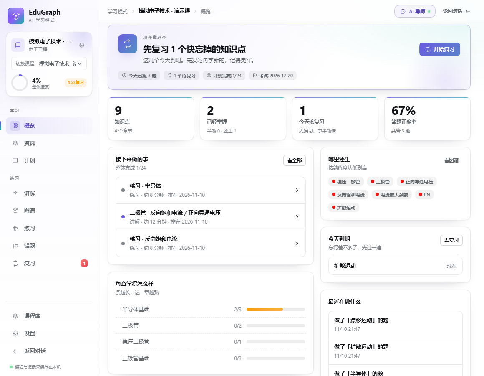

# EduGraph AI · DSH 学习模式

把 DeepSeek Harness（DSH）变成一台能真正带人学完一门课的机器：传资料 → 拆章节和知识点 → 排计划 → 讲解、出题、批改 → 错题与复习。**电路图、波形这类"文字里没有"的东西，也能看到。**



| 知识图谱（按章节聚焦） | 图示（PDF 电路图现渲染） |
|---|---|
|  |  |

| 讲解与主动回忆 | 练习批改 |
|---|---|
|  |  |

## 用到了哪些技术

| 层 | 技术 | 用来干什么 |
|---|---|---|
| 宿主插件 | Node ESM + Cordis（`export const name/inject/apply`） | 注册 HTTP 路由与 18 个 Agent 工具 |
| 浏览器插件 | React 18 + TypeScript（TSX）+ esbuild | 学习面板 UI，编译成 `window.__ModuleLoader__` 惰性 CJS bundle |
| 面板接入 | `ctx.slots.register({name:'main', key:'learning'})` + `ctx.layout.selectPanel` | 与 DSH 原生会话一键切换 |
| 数据 | 本地 JSON（原子写 + 键锁），无数据库 | 课程知识 / 个人学习状态分离存储 |
| PDF | `pdfjs-dist`（legacy build） | 取文字、字号、页面；判定章节层级 |
| PDF 图示 | `pdfjs-dist` + `canvas`（node-canvas） | 把整页**渲染成 PNG**，矢量画的电路图也能看 |
| Office | 自写 OOXML + ZIP（`node:zlib`），零第三方 | DOCX/PPTX/XLSX 解析与内嵌图片抽取 |
| 结构分析 | 自写规则引擎 | 标题识别、概念抽取、前置/相关关系 |
| 检索 | 自写 BM25 + 中英分词（CJK 1/2-gram） | 资料/概念/题目全文检索，带出处 |
| 复习 | 自写 FSRS-5 | 计算每个知识点的下次复习时间 |
| 出题判分 | 自写（定义句挖空、同章干扰项、关键点覆盖） | 选择题/填空/判断/简答与批改 |
| 图谱可视化 | 自绘 SVG + 自写受力布局 | 概念关系图、章节焦点、悬停高亮、缩放平移 |
| 验证 | `node:test`（56 项）、Playwright、DSH 自带 schema 校验器 | 单测、真实浏览器 12 步验收、工具 schema 校验 |

## 图示与电路图怎么解决

电路图有两种存在形式，方案分别处理：

1. **位图**（扫描件、PPT 里贴的图）：直接从 DOCX/PPTX 的 `word/media`、`ppt/media` 里抽出来。
2. **矢量绘制**（PDF 里用线条画的三极管、波形）：文字层里根本没有它。做法是**把整页渲染成图片**——`pdfjs` 解析 + `canvas` 绘制，1.6 倍分辨率，渲染一次缓存到 `courses/<id>/figures/`。

在界面里：

- 资料页 → 翻原文 → 每页上方「看这一页的图（电路图/波形）」按钮，点开就是整页高清图，**查看器里可以直接 ← → 翻页**；
- Word/PPT 资料在列表里有「看图片」，按顺序翻内嵌图片；
- 讲解页 → 每个知识点卡片右上角「看原文图」，直接跳到它出处的那一页；
- AI → 工具 `get_page_image` 返回图片路径，模型用 DSH 自带的 `read_image` 看一眼，就能照着图讲、照着图出题；
- 图片资料（png/jpg）直接作为整页图显示，不经过解析。

`canvas` 是可选依赖：没装上时功能自动降级为提示「缺少 canvas 依赖」，其它功能不受影响。

## 安装

插件是纯 ESM + 一个已构建的浏览器 bundle，不需要构建服务、不需要数据库。

### 方式一：装进 profile（日常使用）

```jsonc
// ~/.dsh/profiles/<profile>/package.json
{
  "dependencies": { "edugraph-learning": "link:D:/slaern/edugraph-learning" },
  "dsh": { "profile": { "bundles": [ /* … */ , "edugraph-learning" ] } }
}
```

```powershell
cd D:\slaern\edugraph-learning; npm install          # 装 pdfjs-dist 与 canvas
cd <profile>; pnpm install --prefer-offline            # 建 link
node D:\slaern\edugraph-learning\scripts\health.mjs # 安装自检（依赖/链接/canvas）
# 重启 DSH，侧栏出现「学习」
```

> 装完必须**重启 DSH**：profile 的插件列表在启动时读取，热更新只覆盖插件代码、不覆盖新装插件。重启后跑一次 `scripts/health.mjs`，六项全 OK 就说明装好了。

### 方式二：不动用户 profile，起一个临时实例

```powershell
node <dsh>/lib/bin.js --profile web --patch dev-patch.example.yml --port 3900 --no-open
```

## 使用

1. **新建课程**：填名字、目标、考试日期、每天能学多久。
2. **传资料**：PDF/Word/PPT/Excel/Markdown/TXT/图片，可多选、可拖拽；解析在后台，关页面不中断。
3. **看计划**：系统按章节顺序和"必须先学谁"排好讲解、练习、小测、复习；可以改目标后重排，已完成的不丢。
4. **学**：讲解页看定义和原文，先自己回忆，再对照；然后做题，做完立刻批改并告诉你错在哪。
5. **补**：错题页按知识点归堆，一键重练；复习页按记忆曲线排好到期任务。
6. **看图**：遇到电路图、波形，点「看这一页的图」。
7. **回对话**：右上角「返回对话」回到 DSH 原生会话，模型、工具权限、历史都不变。

界面上的「现在做这个」永远只给一个下一步，不用自己想到底该干嘛。

## 给 Agent 的能力（18 个工具）

| 分类 | 工具 |
|---|---|
| 资料 | `list_courses`、`get_document_outline`、`read_source`、`search_materials` |
| 图示 | `get_page_image`、`list_document_images` |
| 图谱 | `upsert_concepts`、`upsert_relations` |
| 档案 | `get_student_profile`、`save_student_profile` |
| 计划 | `create_study_plan`、`update_study_plan` |
| 练习 | `create_quiz`、`grade_answer` |
| 进度 | `record_learning_event`、`get_learning_state`、`get_due_reviews`、`get_course_overview` |

工具描述全部用大白话写成，模型照着做就像个正常家教；`courseId` 可省略，会自动用界面上打开的那门课。

本地 HTTP 接口与面板共用：`/plugins/edugraph-learning/api` → `/courses`、`/overview|graph|plan|documents|lesson|quiz|mistakes|reviews|search`、`/documents/:id/pages/:n/image`、`/media`、`/state`、`/profile`、`/health`。

## 数据

```
$DSH_HOME/storages/edugraph-learning/
├── index.json                  课程索引
├── profile.json                跨课程学习档案
├── state.json                  界面状态（当前课程/页面，刷新恢复）
└── courses/<courseId>/
    ├── meta.json               课程 + 章节 + 概念 + 进展 + 计划 + 答题 + 复习
    ├── blocks.json             资料原文块
    ├── documents/              原始上传文件（渲染图片、抽图都靠它）
    └── figures/                按页渲染的图片缓存
```

所有写入是「临时文件 + rename」的原子替换，并用键锁串行化；损坏文件会被识别、备份并报错，不会静默丢数据。

## 开发

```powershell
npm test                       # 56 项测试
npm run build                  # 重新生成 lib/client.js
node scripts/e2e-real.mjs "<一份真实 PDF>"   # 真实课程全链路
node scripts/verify-bundle.mjs               # 客户端 bundle 合同
node scripts/verify-tools.mjs <dsh-tools 的 json-schema.js>   # 用 DSH 校验器验 18 个工具
```

```
lib/           宿主侧：api / service / store / parse / analyze / plan / quiz / grade / fsrs / search / media / tools
src/client/    浏览器侧：index.tsx（面板注册）、ui.tsx、views/*.tsx、styles.css
scripts/       构建与校验脚本
test/          node:test 套件
docs/          工程说明与截图
```

## 已知限制

- 概念/定义来自确定性规则，不是模型推理：印刷教材效果好，手写笔记、公式密集的资料会抽到公式片段，需要模型用 `upsert_concepts` 修，或在图谱里绕开。
- 图片不做 OCR，也不做电路识图：**图能看、能交给模型看**，但不会自动解析成网表。
- 选项生成依赖定义，没有定义的概念只出填空题。
- 单课程上限：220 概念 / 160 任务 / 单文件 80MB；按页渲染一次约 0.5 秒（之后走缓存）。
- 数据只在本机，不做多设备同步。

## 许可

MIT
